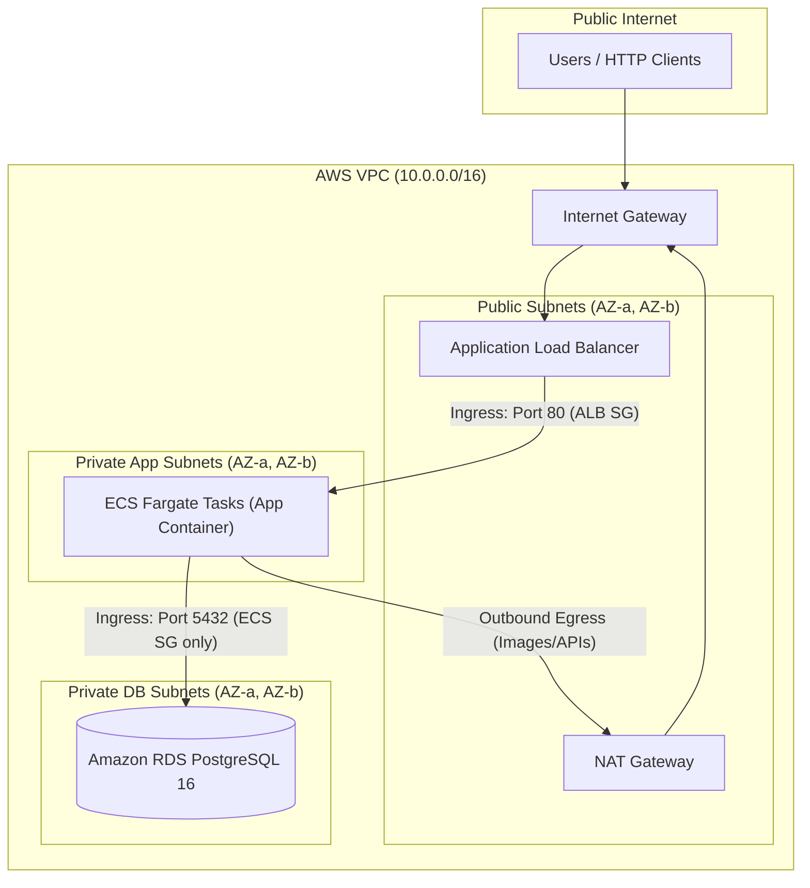

# DevOps Assessment: Terraform + Database Reliability

Production-ready AWS infrastructure design using Terraform alongside local database containerization, data migrations, indexing optimization, automated backup/restore scripts, and GitHub Actions CI.

---

## Architecture Overview

```
Internet
   │
   ▼
[ Internet Gateway ]
   │
   ▼
[ Application Load Balancer (ALB) ] (Public Subnets: AZ-1a, AZ-1b)
   │ Security Group: Inbound 80/443 from 0.0.0.0/0
   ▼
[ ECS Fargate Service ] (Private App Subnets: AZ-1a, AZ-1b)
   │ Security Group: Inbound 80 only from ALB SG
   │ Outbound: Egress via NAT Gateway
   ▼
[ RDS PostgreSQL 16 ] (Private DB Subnets: AZ-1a, AZ-1b)
     Security Group: Inbound 5432 strictly from ECS Task SG
     Isolated: No Public IP, No Internet Gateway route
```



---

## Repository Structure

```
.
├── .github/
│   └── workflows/
│       └── terraform.yml            # CI workflow for format, init, validate, and plan
├── db/
│   ├── init/                        # Docker entrypoint initialization scripts
│   │   ├── 01_create_tables.sql
│   │   ├── 02_create_indexes.sql
│   │   └── 03_seed_data.sql
│   └── migrations/                  # Versioned schema migrations
│       ├── 001_create_tables.sql
│       ├── 002_create_indexes.sql
│       └── 003_seed_data.sql
├── infra/
│   ├── envs/
│   │   ├── dev/                     # Development environment definition
│   │   │   ├── backend.tf
│   │   │   ├── main.tf
│   │   │   ├── outputs.tf
│   │   │   ├── providers.tf
│   │   │   ├── terraform.tfvars
│   │   │   └── variables.tf
│   │   └── prod/                    # Production environment definition
│   │       ├── backend.tf
│   │       ├── main.tf
│   │       ├── outputs.tf
│   │       ├── providers.tf
│   │       ├── terraform.tfvars
│   │       └── variables.tf
│   └── modules/
│       ├── ecs/                     # ECS Cluster, Task Definition, Service, ALB
│       │   ├── main.tf
│       │   ├── outputs.tf
│       │   └── variables.tf
│       ├── network/                 # VPC, Subnets, Route Tables, NAT, Security Groups
│       │   ├── main.tf
│       │   ├── outputs.tf
│       │   └── variables.tf
│       └── rds/                     # RDS PostgreSQL, Parameter Groups, Subnet Groups
│           ├── main.tf
│           ├── outputs.tf
│           └── variables.tf
├── scripts/
│   ├── backup.sh                    # Bash database backup script
│   ├── restore.sh                   # Bash database restore script
│   ├── backup.ps1                   # PowerShell database backup script (Windows native)
│   └── restore.ps1                  # PowerShell database restore script (Windows native)
├── backups/                         # Backup storage directory (.gitkeep)
├── docker-compose.yml               # Local PostgreSQL 16 container definition
├── .gitignore
└── README.md
```

---

## Part 1 & 2: Terraform Infrastructure

### Environment Isolation & Resource Sizing

| Parameter | Development (`dev`) | Production (`prod`) | Rationale |
|---|---|---|---|
| **VPC CIDR** | `10.0.0.0/16` | `10.100.0.0/16` | Distinct CIDRs prevent network collisions |
| **ECS Task CPU / Memory** | `256` / `512 MB` | `1024` / `2048 MB` | Sized for baseline vs high concurrent production loads |
| **ECS Desired Count** | `1` | `2` | Single replica for dev; multi-AZ high availability for prod |
| **NAT Gateways** | `1` (Single NAT) | `2` (One per AZ) | Minimizes cost in dev; ensures full AZ redundancy in prod |
| **RDS Instance Class** | `db.t4g.micro` | `db.r6g.large` | Cost-optimized burstable for dev; memory-optimized Graviton for prod |
| **RDS Storage** | `20 GB` (max `50 GB`) | `100 GB` (max `500 GB`) | Auto-scaling storage enabled with production headroom |
| **Multi-AZ Deployment** | `false` | `true` | Dev single instance; Prod synchronous standby replica |
| **Backup Retention** | `1 day` | `30 days` | Dev short retention; Prod 30-day continuous PITR window |
| **Deletion Protection** | `false` | `true` | Prevents accidental deletion in production |
| **Final Snapshot** | Skipped | Created (`tripare-prod-postgres-final-snapshot`) | Guarantees recovery state on decommission |

### Security Model
1. **ALB Security Group**:
   - Ingress: HTTP (80) & HTTPS (443) from `0.0.0.0/0`.
   - Egress: Forward traffic to ECS security group on container port.
2. **ECS Task Security Group**:
   - Ingress: Port 80 strictly allowed from ALB Security Group only (`security_groups = [aws_security_group.alb.id]`).
   - Egress: Outbound for container image pulls and database access.
3. **RDS Database Security Group**:
   - Ingress: Port 5432 strictly allowed from ECS Task Security Group only (`security_groups = [aws_security_group.ecs.id]`).
   - No direct internet access; RDS deployed in isolated private subnets with no route to IGW.

### Terraform Verification Commands

#### Format Check
```bash
terraform fmt -check -recursive infra/
```

#### Development (`dev`)
```bash
cd infra/envs/dev
terraform init
terraform validate
terraform plan -refresh=false
```

#### Production (`prod`)
```bash
cd infra/envs/prod
terraform init
terraform validate
terraform plan -refresh=false
```

---

## Part 3: GitHub Actions CI

The `.github/workflows/terraform.yml` pipeline automates verification on every Pull Request and push to `main`:
1. `terraform fmt -check -recursive infra/` verifies code formatting.
2. Runs matrix strategy for both `dev` and `prod`.
3. Runs `terraform init` and `terraform validate`.
4. Runs `terraform plan -refresh=false -no-color` with plan artifacts uploaded (`actions/upload-artifact@v4`).
5. Publishes plan summaries directly to `$GITHUB_STEP_SUMMARY` and adds a status comment to Pull Requests.

---

## Part 4 & 5: Local Database & Query Optimization

### Starting Local Database

Start PostgreSQL 16 using Docker Compose:
```bash
docker compose up -d
```

Verify the service status:
```bash
docker compose ps
```

The container automatically mounts `./db/init` to `/docker-entrypoint-initdb.d/`, initializing the schema, indexes, and seed data.

### Schema Details
- `hotel_bookings`: Tracks booking entities (`id`, `org_id`, `hotel_id`, `city`, `checkin_date`, `checkout_date`, `amount`, `status`, `created_at`).
- `booking_events`: Tracks lifecycle events (`id`, `booking_id`, `event_type`, `payload JSONB`, `created_at`).

### Seed Data
The database is seeded with 160 realistic hotel bookings and 352 lifecycle events spanning:
- **8 Cities**: `delhi`, `mumbai`, `bangalore`, `jaipur`, `goa`, `hyderabad`, `chennai`, `kolkata`.
- **5 Organizations**: UUID keys `a0000000-0000-0000-0000-000000000001` through `...005`.
- **5 Booking Statuses**: `CONFIRMED`, `CANCELLED`, `CHECKED_IN`, `CHECKED_OUT`, `PENDING`.
- **Event Types**: `BOOKING_CREATED`, `PAYMENT_SUCCESS`, `GUEST_CHECKED_IN`, `BOOKING_CANCELLED` with rich JSONB payloads.
- **Date Spread**: Spread across recent 30 days and older dates (> 30 days) to validate date-filter predicates.

### Query Optimization

Target Query:
```sql
SELECT org_id, status, COUNT(*), SUM(amount)
FROM hotel_bookings
WHERE city = 'delhi'
AND created_at >= NOW() - INTERVAL '30 days'
GROUP BY org_id, status;
```

#### Indexing Strategy & Rationale

1. **Composite B-Tree Filter Index**:
   ```sql
   CREATE INDEX IF NOT EXISTS idx_hotel_bookings_city_created_at
   ON hotel_bookings (city, created_at);
   ```
   - **Rationale**: B-Tree efficiency requires equality columns (`city = 'delhi'`) to appear first, followed by range comparison columns (`created_at >= ...`). This permits PostgreSQL to seek directly to the matching city and slice the date range without scanning irrelevant cities.

2. **Covering Index (Index-Only Scan)**:
   ```sql
   CREATE INDEX IF NOT EXISTS idx_hotel_bookings_reporting_covering
   ON hotel_bookings (city, created_at)
   INCLUDE (org_id, status, amount);
   ```
   - **Rationale**: The `INCLUDE` clause appends payload columns required by `SELECT` and `GROUP BY` into the index leaf pages without expanding the non-leaf B-tree navigation nodes. This enables PostgreSQL to execute an **Index-Only Scan** with `Heap Fetches: 0`, completely eliminating table heap lookups and significantly reducing disk I/O.

3. **Foreign Key Index**:
   ```sql
   CREATE INDEX IF NOT EXISTS idx_booking_events_booking_id
   ON booking_events (booking_id);
   ```
   - **Rationale**: Optimizes parent-child joins and foreign key cascade lookups between `hotel_bookings` and `booking_events`.

#### Query Execution Plan Verification (`EXPLAIN ANALYZE`)

```sql
Index Only Scan using idx_hotel_bookings_reporting_covering on hotel_bookings
  Index Cond: ((city = 'delhi'::text) AND (created_at >= (now() - '30 days'::interval)))
  Heap Fetches: 0
  Buffers: shared hit=4 read=2
  Planning Time: 8.425 ms
  Execution Time: 1.022 ms
```

---

## Part 6: Database Backup & Restore

### Automated Backup Script

Creates a timestamped database dump in the `backups/` directory.

#### Linux / macOS / Git Bash:
```bash
./scripts/backup.sh
```

#### Windows PowerShell:
```powershell
.\scripts\backup.ps1
```

Generated artifact format:
`backups/backup_YYYYMMDD_HHMMSS.sql`

### Automated Restore Script

Restores the database dump into a fresh database (`hotel_booking_db_restored`), validating data integrity and running benchmark verification queries.

#### Linux / macOS / Git Bash:
```bash
# Restores the latest dump automatically:
./scripts/restore.sh

# Or restore a specific dump:
./scripts/restore.sh backups/backup_20261113_101405.sql
```

#### Windows PowerShell:
```powershell
# Restores the latest dump automatically:
.\scripts\restore.ps1

# Or restore a specific dump:
.\scripts\restore.ps1 -BackupFilePath .\backups\backup_20261113_101405.sql
```

### How to Verify That Restore Worked Successfully

The restore script automatically executes and outputs verification checks against the fresh restored database:

1. **Table Existence & Record Counts**:
   ```sql
   SELECT 
       (SELECT COUNT(*) FROM hotel_bookings) AS total_hotel_bookings,
       (SELECT COUNT(*) FROM booking_events) AS total_booking_events;
   ```
   Expected Output:
   - `total_hotel_bookings`: **160**
   - `total_booking_events`: **352**

2. **Assessment Query Verification**:
   ```sql
   SELECT org_id, status, COUNT(*), SUM(amount)
   FROM hotel_bookings
   WHERE city = 'delhi'
   AND created_at >= NOW() - INTERVAL '30 days'
   GROUP BY org_id, status;
   ```
   Expected Output:
   Returns 5 grouped rows corresponding to each active organization and booking status with matching aggregated row counts and amounts.

3. **Direct psql Verification Command**:
   ```bash
   docker exec -it hotel_db psql -U postgres -d hotel_booking_db_restored -c "SELECT COUNT(*) FROM hotel_bookings;"
   ```

---

## Review Command Summary

### Terraform:
```bash
terraform fmt -check -recursive infra/
cd infra/envs/dev && terraform init && terraform validate && terraform plan -refresh=false
cd ../prod && terraform init && terraform validate && terraform plan -refresh=false
```

### Database Tasks:
```bash
docker compose up -d
./scripts/backup.sh
./scripts/restore.sh
```
